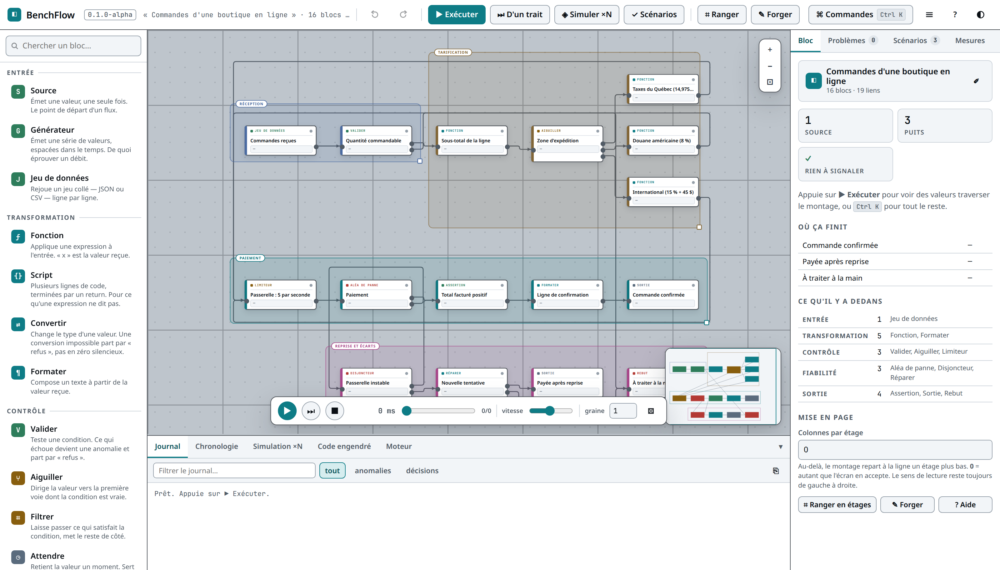

# BenchFlow

[](https://github.com/AILabManager-tech/benchflow/actions/workflows/verification.yml)
[](https://github.com/AILabManager-tech/benchflow/actions/workflows/pages.yml)


**▶ Essayer en ligne : <https://ailabmanager-tech.github.io/benchflow/>**

*Simulateur de pipelines : on monte un schéma-bloc, on l'exécute, et on regarde les
valeurs le traverser. Un seul fichier HTML, aucune dépendance, interface en français.*

> **À ne pas confondre** avec [BenchFlow](https://github.com/benchflow/benchflow), le banc
> d'essai de moteurs de workflow BPMN 2.0 de l'USI. Même nom, autre outil : ici on **conçoit
> et simule** un pipeline, on ne mesure pas les performances d'un moteur d'exécution.



Un bac à sable pour **concevoir un pipeline, puis le faire tourner**. On pose des blocs,
on tire des fils, on donne une fonction à chacun — et des valeurs typées traversent le
montage pendant qu'une horloge simulée avance, que les files se remplissent et que les
pannes arrivent.

Sert à **éprouver une idée de pipeline avant de l'écrire en code** : où une valeur se perd,
ce qu'une validation refuse, ce qu'une reprise bornée absorbe, ce qui finit chez l'humain,
et ce que tout ça coûte en temps.

Un seul fichier HTML. Aucune dépendance. Ouvrable hors ligne, pour toujours.

> ### ⚠ Un montage est du code, pas un document
>
> Les expressions des blocs et le corps des blocs forgés sont du **JavaScript, exécuté
> tel quel** dès qu'on appuie sur Exécuter. C'est tout l'intérêt de BenchFlow — et ça veut
> dire qu'**ouvrir un `.benchflow.json` reçu de quelqu'un revient à lancer son code**.
>
> Traite un montage venu d'ailleurs comme tu traiterais un script : lis-le avant. Le
> panneau **Code engendré**, onglet *Montage brut*, montre le contenu exact d'un fichier
> sans rien exécuter. Le masquage de `Math` et `Date` décrit plus bas sert le
> déterminisme, **pas** la sécurité : ce n'est pas un bac à sable et ça n'arrête personne
> qui essaie.

## Lancer

- l'icône **BenchFlow** dans le menu d'applications, ou
- `benchflow` au terminal, ou
- ouvrir `atelier.html` dans un navigateur.

Le lanceur ouvre une fenêtre d'application sans barre d'adresse, avec son propre profil de
navigateur — le montage sauvegardé lui appartient et ne se mélange pas au reste.

## Les trois principes tenus

**Aucun repli silencieux.** Un mode inconnu, une expression fautive, une conversion
impossible produisent une *anomalie qui voyage* sur un fil — jamais un zéro par défaut. Un
bloc qui ne sait pas traiter une anomalie ne l'avale pas : il la retransmet telle quelle,
sans exécuter sa fonction, et le journal le dit.

**Rien n'est masqué.** Chaque valeur qui passe s'affiche sur son fil, chaque décision est
journalisée avec son instant simulé, chaque file d'attente se compte, chaque bloc rapporte
son taux d'occupation.

**Reproductible.** Tout le hasard vient d'une graine — même graine, même exécution,
sinon un scénario ne voudrait rien dire. La garantie couvre aussi le code que *tu* écris :
dans une expression, un bloc Script ou un bloc forgé, `Math.random()`, `Date.now()` et
`new Date()` sans argument **lèvent** une erreur explicite, qui devient une anomalie sur le
fil et une ligne de journal. `hasard()` tire de la graine ; le reste de `Math` et une date
construite avec un argument passent inchangés.

Ce que ça n'est pas : un bac à sable. Du code déterminé à s'échapper y arrive. Ce qui est
fermé, c'est l'accident — le seul cas qui se produit vraiment.

## Ce qu'il y a dedans

**25 comportements** répartis en six familles :

| Famille | Blocs |
|---|---|
| Entrée | Source, Générateur (suite / uniforme / normale / liste), Jeu de données (CSV ou JSON) |
| Transformation | Fonction, Script, Convertir, Formater |
| Contrôle | Valider, Aiguiller (*n* voies), Filtrer, Attendre, Limiteur de débit |
| Agrégation | Fusionner, Fenêtre, Accumuler, Compter, Statistiques |
| Fiabilité | Réparer (budget + usure + backoff), Disjoncteur, Aléa de panne, Refuser |
| Sortie | Sortie, Rebut, Assertion, Sonde |

À l'ouverture, BenchFlow charge le **traitement des commandes d'une boutique en ligne**.
Ce ne sont pas des entiers déguisés : dix vraies lignes de commande entrent par un jeu de
données CSV, chaque bloc lit des champs qui existent — quantité, prix unitaire, pays — et
applique une règle qu'on pourrait défendre en réunion. Une quantité de 0 ou de 40 est
refusée, le sous-total s'ajoute à l'enregistrement, l'expédition s'aiguille par zone
(taxes du Québec, douane américaine, forfait international), le paiement passe par une
passerelle limitée à cinq appels par seconde qui tombe parfois en panne, une reprise
bornée rattrape ce qu'elle peut, et le reste part au traitement manuel.

On voit l'enregistrement s'enrichir en traversant : `objet · 5 champs` à l'entrée,
`6 champs` après le sous-total, `8 champs` après la taxe et la facture. Changer un taux
et regarder les totaux bouger prend dix secondes — c'est la différence entre un schéma
et un modèle.

**Six types de valeur** : nombre, texte, booléen, liste, objet, anomalie. Les types se
propagent statiquement dans le graphe : on connaît le type porté par un fil avant
d'exécuter quoi que ce soit.

**Cinq réglages avancés sur *tous* les blocs** : temps de traitement, variation du temps,
coût par valeur, traitements simultanés (d'où les files d'attente), et taux de panne
aléatoire. Sans eux un pipeline n'est qu'un dessin ; avec eux, c'est un modèle.

**Blocs forgés.** La forge (`✎ Forger`) permet d'écrire son propre comportement : ses
ports, ses réglages, son code. Un bloc forgé se comporte ensuite comme les autres et
voyage dans le fichier du montage — donc il se partage avec lui.

## Sections et étages

Un **encadré de section** regroupe des blocs pour expliquer. Un bloc lui appartient quand
son **centre** est dedans — règle franche, qui se juge à l'œil, et qui décide aussi bien du
déplacement groupé que de la couleur : la barre de gauche d'un bloc prend la couleur de sa
section, sa pastille d'en-tête garde celle de sa famille. Si deux encadrés se recouvrent, le
plus petit l'emporte.

Quand le montage s'allonge au-delà de l'écran, **`Ctrl R` le range en étages** : les vagues
se suivent de gauche à droite, et le surplus repart à la ligne un étage plus bas. Le sens de
lecture reste unique — alterner le sens raccourcirait les fils de raccord au prix de la
seule chose qui compte dans un schéma de principe. Le nombre de colonnes par étage se règle
dans le panneau du montage (`0` = autant que l'écran en accepte) ; `Ctrl E` force des étages
courts.

## Le temps

L'exécution se calcule **d'un trait** — un ordonnanceur à événements discrets, sans
animation — puis **s'enregistre**. La barre du bas rejoue cet enregistrement : pas à pas,
à vitesse réglable, en avant comme en arrière. Ce qu'on regarde n'est jamais le calcul,
c'est sa relecture. D'où le retour en arrière gratuit.

- **Chronologie** — un diagramme de Gantt de tous les traitements.
- **Mesures** — durée, débit, coût, occupation par bloc, file maximale, et la désignation
  du goulot d'étranglement.
- **Simulation ×N** — rejoue le montage N fois avec N graines, et donne la distribution :
  moyenne, p95, écart-type, histogrammes, ce qui arrive à chaque puits.

## Scénarios

Un scénario fige des entrées et une graine, puis énonce ce qu'on attend : ce qu'un puits
doit recevoir, combien, combien d'anomalies, quelle durée maximale, quel coût. C'est le
test unitaire du montage — après chaque modification, on sait tout de suite ce qu'on a
cassé. Les blocs **Assertion** posés dans le flux alimentent les mêmes résultats.

Les cinq montages d'exemple livrés viennent avec leurs scénarios, tous verts.

## Ce qui sort d'ici

- **JavaScript** — un fichier autonome qui embarque le moteur et les fonctions
  réellement exécutées, obtenues par `Function.toString`. Ce qui tourne dans la page et
  ce qui tourne dans le fichier sont le *même code* : aucune dérive possible.
  `node montage.js` donne exactement le même journal que BenchFlow.
- **Python** — traduction fidèle du **flux** : mêmes blocs, mêmes ports, mêmes règles de
  propagation des anomalies. Les expressions JavaScript passent par un traducteur restreint
  qui échoue bruyamment plutôt que d'inventer.

  Quatre choses ne traversent pas la frontière, et il vaut mieux le savoir avant de
  s'appuyer dessus :

  | | |
  |---|---|
  | **L'horloge simulée** | Ni latence, ni gigue, ni file d'attente, ni débit, ni coût, ni traitements simultanés. Des cinq réglages avancés, seul le **taux de panne** traverse. Un montage Python dit *ce qui sort*, jamais *combien de temps ça prend*. |
  | **Les blocs Script** | Leur corps reste du JavaScript. Le fichier Python lève une erreur nommant le bloc, au lieu de deviner. |
  | **Les blocs forgés** | Pareil, et pour la même raison. À réécrire en Python, ou à garder dans BenchFlow. |
  | **Les scénarios** | Ils ne sont pas exportés. Les blocs **Assertion** posés dans le flux, eux, traversent et rapportent leurs résultats. |
- **schema.json** pour la skill `/blocs`, **Mermaid**, et le montage brut.

## Raccourcis

`Ctrl K` ouvre la palette de commandes — tout y est. Les principaux :

| | |
|---|---|
| `Ctrl ⏎` / `Maj ⏎` | exécuter avec ou sans animation |
| `Espace` · `←` `→` | jouer/pause · reculer/avancer d'un événement |
| `Ctrl Z` / `Ctrl ⇧ Z` | annuler / rétablir |
| `Ctrl C` `Ctrl V` `Ctrl D` | copier, coller, dupliquer |
| `Ctrl A` · `Maj + glisser` | tout sélectionner · sélection par cadre |
| `Ctrl R` · `Ctrl 0` | ranger par vagues · tout voir |
| `Ctrl S` | enregistrer dans un fichier |
| `?` | aide complète |

## Accessibilité

Ce qui est tenu, et vérifié à chaque passage de `verifier.mjs` :

- **Contraste** — 132 paires de couleurs au-dessus du seuil, dans les deux thèmes :
  le texte (AA, 4,5:1), les surfaces entre elles (1.4.11, 3:1), et l'anneau de focus
  contre les quatre fonds qu'il peut rencontrer.
- **Focus visible** — anneau de 2 px au `:focus-visible` sur tout élément atteignable
  au clavier. Il a son propre jeton `--focus` parce que la couleur d'accent tombait à
  2,84:1 contre le canevas ; le contrôle l'a attrapée.
- **Noms accessibles** — chaque bouton, champ et bascule en a un. Zéro élément anonyme.
- **Structure** — `<!DOCTYPE html>`, `lang="fr-CA"`, les trois superpositions sont des
  `role="dialog"` avec `aria-modal`, et les messages passagers un `role="status"`.
- **`prefers-reduced-motion`** — respecté.

### Limitation connue : la navigation clavier du graphe

**On ne peut pas construire un montage entièrement au clavier.** Poser un bloc, tirer un
fil, déplacer un encadré : tout ça demande la souris. Le canevas est déclaré
`role="application"` et le dit dans son libellé.

Ce n'est pas un oubli, c'est un sous-projet : il faudrait un ordre de parcours entre les
blocs, une façon de désigner un port, une autre de viser sa cible, un modèle de sélection
au clavier, et l'ensemble reste utilisable au lecteur d'écran. Annoncé plutôt que
sous-entendu.

Ce qui **est** au clavier : `Ctrl K` ouvre la palette de commandes, et tout ce que fait
BenchFlow y est atteignable — exécuter, ranger, exporter, changer de thème, charger un
exemple. Un montage déjà construit s'explore, s'exécute et se rejoue sans souris.

## Vérification

Le fichier est coupé en deux moitiés par les marqueurs `@noyau:debut` / `@noyau:fin`. Le
**noyau** — types, catalogue, moteur, diagnostics, scénarios, engendrement de code — ne
touche jamais au DOM. Il tourne donc tel quel hors du navigateur :

```
node verifier.mjs        232 assertions · 132 paires de couleurs au-dessus du
                         seuil de contraste · engendre et exécute les 5 exemples
                         en JavaScript et en Python
node verifier.mjs -v     détail de chaque assertion
node verifier.mjs --rapide   assertions seulement
```

Les deux traductions d'un même montage sont aussi **comparées entre elles** : pour les
montages sans hasard, ce que produit le JavaScript engendré et ce que produit le Python
doivent coïncider ligne pour ligne. C'est ce contrôle qui a révélé qu'un repli du bloc
Réparer manquait côté Python, et que la sérialisation JSON des deux langages ne s'accordait
pas sur `240` contre `240.0`.

Le contrôle de contraste lit les couleurs **dans la feuille de style elle-même** et vérifie
132 paires des deux thèmes : le texte contre son fond (seuil AA, 4,5:1) **et les surfaces
entre elles** (seuil 1.4.11, 3:1) — bordure d'un bloc contre le canevas, corps du bloc
contre le canevas, trait contre panneau. Les deux axes sont nécessaires : la première
version passait le contrôle du texte pendant que les blocs se fondaient dans le fond à
1,09:1. Un seul jeton mal réglé suffit à faire basculer vingt textes sous le seuil sans que
rien ne l'annonce.

Les mêmes assertions tournent dans la page, onglet **Moteur**. Un seul jeu de tests, deux
endroits pour le lancer.

```
node mutation.mjs        casse chaque correctif un par un et exige
                         que la suite devienne rouge
node sonde.mjs           charge la page dans Chrome, refuse la moindre erreur
                         console ET la moindre requête réseau
```

Les trois commandes tournent à chaque poussée sur GitHub Actions, et la démo
n'est pas publiée si l'une d'elles est rouge.

**« Aucune requête réseau » est vérifié, pas seulement affirmé.** La sonde
écoute le trafic : la page ne doit émettre qu'une requête, elle-même. Une
police distante ou une image d'aperçu glissée un jour dans l'en-tête casserait
« ouvrable hors ligne » — et publierait l'adresse IP de qui l'ouvre — sans que
rien ne le dise. Le contrôle a été éprouvé en lui injectant une police Google :
deux requêtes, rouge immédiat.

Une suite verte ne prouve rien tant qu'on n'a pas vérifié qu'elle sait devenir rouge. Le
banc de mutation remet le code fautif d'origine à la place de chaque correctif et refuse
de passer si les assertions restent vertes. Il a trouvé, à son premier essai, un correctif
qu'aucune assertion ne couvrait.

Un groupe d'assertions porte le nom **« Aucun repli silencieux »** : il tient en respect les
chemins par lesquels une valeur pourrait disparaître sans un mot — fil vers un bloc absent,
lot jamais complété, générateur coupé par une limite, enregistrement tronqué, anomalie
changée en texte anodin, fil rebranché sur un autre port après un changement de réglage,
port d'un bloc forgé écarté parce que son nom était impossible.
Chacun de ces cas a existé dans le code et a été refermé ; les assertions sont là pour
qu'ils ne reviennent pas.

## Reprise de l'esquisse

Un montage ouvert depuis un fichier passe d'abord par une remise d'aplomb : identifiants
uniques, fils dont les deux extrémités existent, noms de port possibles. Ce n'est jamais
fait en douce — une boîte énumère chaque retouche.

Cette remise d'aplomb répare la *structure* du montage ; elle ne juge pas le code qu'il
transporte. Ce qui reste vrai de bout en bout : ouvrir un montage reçu, c'est lancer son
code — voir l'avertissement en tête de ce fichier.

L'esquisse précédente enregistrait son montage sous la clé `atelier`. Au premier
démarrage, s'il en existe un, il est **converti et chargé**, avec un récapitulatif de ce
qui a changé (`Transformer` devient `Fonction` ; `Aiguiller` passe d'une condition unique à
une table de voies, `oui`/`non` devenant `voie 1`/`autre`). L'ancienne sauvegarde n'est
jamais effacée.

## Fichiers

```
atelier.html    l'application entière — noyau (§0-§11) puis interface (§12-§22)
verifier.mjs    lance les auto-tests du noyau sous Node, hors navigateur
mutation.mjs    vérifie que ces auto-tests savent devenir rouges
sonde.mjs       pilote la page dans Chrome headless pour vérifier l'interface
capture.mjs     refait capture.png et capture-sombre.png à la commande
.github/        vérification.yml (assertions + mutation + sonde) et
                pages.yml (démo, qui ne publie pas sans vérifier d'abord)
CLAUDE.md       invariants du projet, à l'usage d'un agent qui vient y toucher
README.md       ce fichier
LICENSE         MIT
```

`sonde.mjs` et `capture.mjs` sont les seuls fichiers à demander autre chose que
Node — il leur faut Chrome. Ce sont des outils de développement : l'application,
elle, n'a toujours aucune dépendance.

La capture du README se **régénère** (`node capture.mjs`) plutôt que d'être collée
une fois pour toutes : une image d'interface qui ne se refait pas se périme sans
le dire.

## Version et licence

`0.1.0-alpha` — première version publiable. Le numéro s'affiche dans l'en-tête,
voyage dans chaque fichier engendré, et trois assertions vérifient qu'il y est.

À ne pas confondre avec la **version de format** des montages enregistrés
(`VERSION_FORMAT`, actuellement 2) : les deux bougent séparément.

Sous licence **MIT** — voir `LICENSE`.
